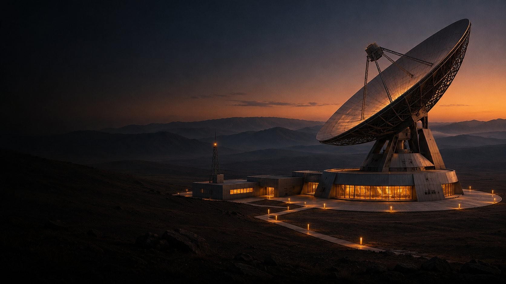
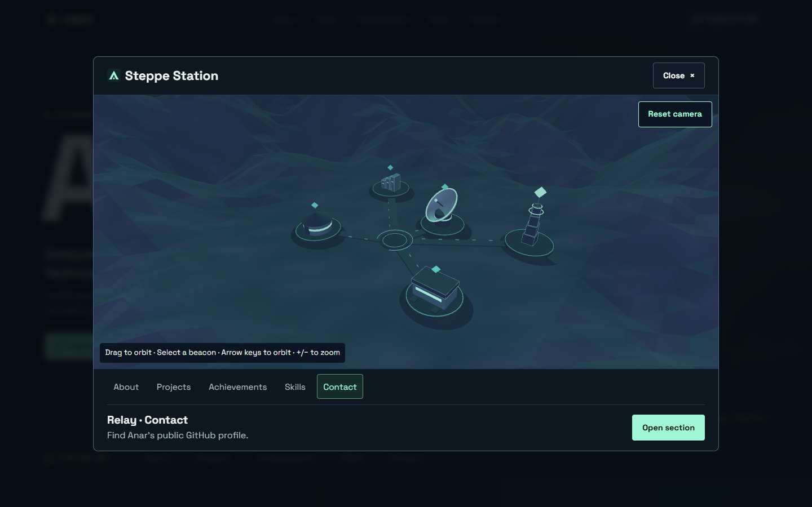

<h1 align="center">Anar</h1>

  <strong>Computer science student and developer</strong> 
  Shine Mongol Koosen · Ulaanbaatar, Mongolia

  

I build software and interactive prototypes, independently and with teammates. My projects span web applications, physical game controls, and experiments in 3D and video production.

## Selected projects

<table>
  <tr>
    <td width="50%" valign="top">
      <h3>Planetary Twin</h3>
      
<strong>Completed competition submission</strong>

      
A team concept for finding places on Earth that resemble specific lunar or Martian environments.

    </td>
    <td width="50%" valign="top">
      <h3>Duck Hunt</h3>
      
<strong>Competition prototype</strong>

      
A game prototype exploring physical input with an Arduino-based controller.

      
<code>Unity</code> <code>Arduino</code>

    </td>
  </tr>
  <tr>
    <td width="50%" valign="top">
      <h3>ShopApp</h3>
      
<strong>In development</strong>

      
A web application for basic shop operations.

    </td>
    <td width="50%" valign="top">
      <h3>Mongolian Shorts Studio</h3>
      
<strong>Experimental prototype</strong>

      
An exploration of how AI-assisted development, 3D animation, and video processing fit into a short-form production workflow.

      
<code>Codex</code> <code>Blender</code> <code>FFmpeg</code>

    </td>
  </tr>
</table>

### Steppe Station

My developer portfolio with an interactive 3D observatory. **In Development / Awaiting Deployment.**

## Programming and technology

| Area | Project experience and interests |
| --- | --- |
| **Software and data** | Java, object-oriented programming, web applications, SQL and MySQL |
| **Interactive systems** | Unity, Arduino, hardware–software integration |
| **Creative workflows** | Blender, FFmpeg, 3D animation, and AI-assisted development |
| **Version control** | Git and GitHub |

My public [Remix Admin Template repository](https://github.com/AnarHacker/remix-admin-template) contains a TypeScript, Remix, and Supabase starter.

## Competition participation

**2026 NASA Space Apps Challenge · Ulaanbaatar.** I participated as part of the team that completed the Planetary Twin submission. [Ulaanbaatar event site](https://www.spaceappsulaanbaatar.com/)

## Portfolio and contact

- [**Steppe Station — In Development / Awaiting Deployment**](#steppe-station)
- **GitHub** · [@AnarHacker](https://github.com/AnarHacker)
